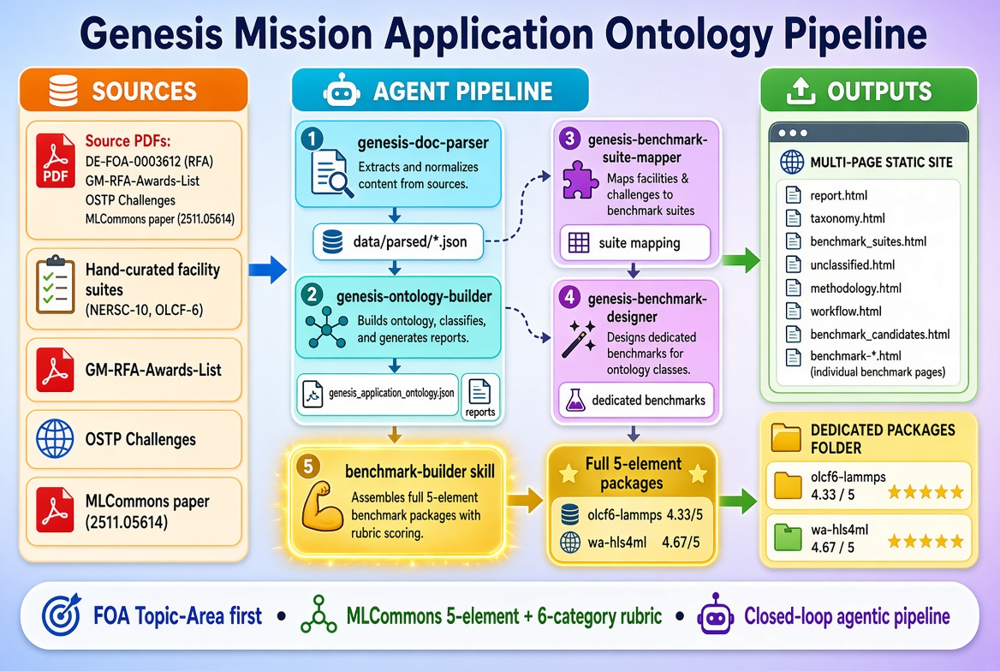

# Project Summary: Agentic GROMACS Performance Engineering

## Overview
This project implements a professional-grade, agentic framework for the installation, execution, and optimization of GROMACS simulations, specifically targeting high-performance environments such as Apple Silicon (M1/M2/M3) and NVIDIA A100 enterprise clusters.

The core objective is to transition from manual performance tuning to an autonomous, evidence-based optimization loop that maximizes simulation throughput (ns/day) while strictly maintaining scientific and numerical validity.

---

## 🏗️ System Architecture

The project is structured into three synergistic layers:

### 1. Execution Layer (Standalone Tooling)
Direct, shell-accessible tools for immediate deployment.
- **M1 Toolkit**: A complete suite for Apple Silicon (`platform/ai/m1/`) providing installation, profiling-ready compilation, and visual analysis.
- **Docker Integration**: Containerized environments for CPU and CUDA workloads, ensuring isolation and portability.
- **Cluster Scripts**: Automated pipelines for CUDA builds and Slurm-based execution on HPC systems.

### 2. Instruction Layer (Expert Skills)
A library of structured workflows that guide an AI agent through complex GROMACS tasks.
- **Simulation Lifecycle**: End-to-end guidance from PDB setup to trajectory post-processing.
- **Modern Profiling**: A high-resolution suite using `perf`, `Callgrind`, and `Py-Spy` to identify bottlenecks via Flame Graphs.
- **Performance Optimization**: The "Insight Pipeline" that transforms raw profiling data into actionable code and parameter changes.
- **ModCon Integration**: Advanced auto-tuning and data preparation logic leveraging the AI-ModCon framework.

### 3. Integration Layer (MCP Servers)
Native APIs that provide the AI with structured, real-time access to the environment.
- **Slurm Bridge**: Native interaction with the cluster workload manager.
- **GMX Docs (RAG)**: A vector-search server providing certified references from the official GROMACS manual.
- **Profile API**: Binary parsing of `perf.data` and `callgrind` files into structured JSON.
- **Hardware Telemetry**: Real-time monitoring of GPU/CPU health and utilization.
- **VMD Bridge**: Remote control of the VMD visualization console.

---

## 🤖 The Agentic Framework

The project's most advanced feature is the transition to a multi-agent orchestration pattern. The framework employs five specialized personas to automate the optimization cycle:

1. **The Architect**: Defines the performance goal and manages the optimization ledger.
2. **The Profiler**: Captures and analyzes high-resolution bottlenecks.
3. **The Optimizer**: Designs technical fixes using the GMX Manual RAG.
4. **The Validator**: Ensures numerical stability and prevents "physics drift."
5. **The Cluster Op**: Manages resource allocation and hardware health.

**The Loop**: Plan $\rightarrow$ Probe $\rightarrow$ Diagnose $\rightarrow$ Implement $\rightarrow$ Verify $\rightarrow$ Evaluate.

---

## 🚀 Key Deliverables
- **Lattice of Skills**: 15+ expert skills covering the entire simulation lifecycle.
- **Native Toolset**: A complete set of MCP servers for system integration.
- **M1 Fast-Path**: A streamlined "Install $\rightarrow$ Run $\rightarrow$ Profile" workflow for Apple Silicon.
- **Documentation**: Integrated READMEs, a detailed project report, and a roadmap for future autonomous capabilities.

## Conclusion
The result is a "Closed-Loop" performance system. By combining native hardware access (MCP), expert domain knowledge (Skills), and autonomous orchestration (Agentic Framework), the project eliminates the guesswork from GROMACS optimization and provides a scalable path to maximum hardware utilization.
