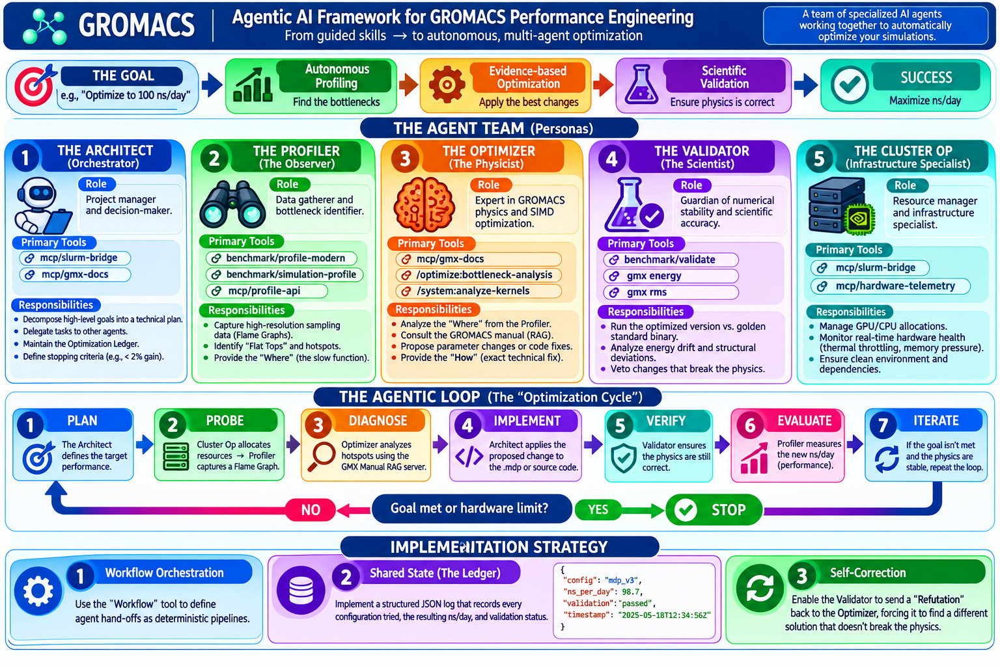

# Agentic AI Framework for GROMACS Performance Engineering

This document outlines the transition from a "Skill-based" approach (where the AI follows guided instructions) to an **"Agentic Framework"** (where a team of specialized AI agents autonomously orchestrates the optimization of a simulation).

## 🎯 The Goal
To move from manual intervention to an autonomous loop:
**Goal (e.g., "Optimize to 100 ns/day")** $\rightarrow$ **Autonomous Profiling** $\rightarrow$ **Evidence-based Optimization** $\rightarrow$ **Scientific Validation** $\rightarrow$ **Success**.

---

## 🤖 The Agent Team (Personas)

To achieve this, the framework employs a multi-agent orchestration pattern where each agent has a distinct persona and a specific set of tools (Skills + MCP).

### 1. The Architect (Orchestrator)
*   **Role**: The project manager and decision-maker.
*   **Primary Tools**: `mcp/slurm-bridge`, `mcp/gmx-docs`.
*   **Responsibilities**:
    *   Decompose high-level goals into a technical plan.
    *   Delegate tasks to the Profiler, Optimizer, and Validator.
    *   Maintain the "Optimization Ledger" (history of all attempts).
    *   Define the stopping criteria (e.g., "performance gain < 2%" or "numerical drift > threshold").

### 2. The Profiler (The Observer)
*   **Role**: The data gatherer and bottleneck identifier.
*   **Primary Tools**: `benchmark/profile-modern`, `benchmark/simulation-profile`, `mcp/profile-api`.
*   **Responsibilities**:
    *   Capture high-resolution sampling data (Flame Graphs).
    *   Identify "Flat Tops" and hotspots in the call stack.
    *   Provide the "Where" (the specific function or kernel that is slow).

### 3. The Optimizer (The Physicist)
*   **Role**: The expert in GROMACS physics and SIMD optimization.
*   **Primary Tools**: `mcp/gmx-docs`, `/optimize:bottleneck-analysis`, `/system:analyze-kernels`.
*   **Responsibilities**:
    *   Analyze the "Where" provided by the Profiler.
    *   Consult the GROMACS manual (via RAG) to find the most efficient parameters.
    *   Propose specific code changes or `.mdp` modifications.
    *   Provide the "How" (the exact technical fix).

### 4. The Validator (The Scientist)
*   **Role**: The guardian of numerical stability and scientific accuracy.
*   **Primary Tools**: `benchmark/validate`, `gmx energy`, `gmx rms`.
*   **Responsibilities**:
    *   Run the "Optimized" version against the "Golden Standard" binary.
    *   Analyze energy drift and structural deviations.
    *   Veto any optimization that improves speed but compromises the physics.

### 5. The Cluster Op (The Infrastructure Specialist)
*   **Role**: The resource manager.
*   **Primary Tools**: `mcp/slurm-bridge`, `mcp/hardware-telemetry`.
*   **Responsibilities**:
    *   Manage GPU/CPU allocations.
    *   Monitor real-time hardware health (thermal throttling, memory pressure).
    *   Ensure the environment is clean and dependencies are correct.

---

## 🔄 The Agentic Loop (The "Optimization Cycle")

The framework operates in a continuous loop until the goal is reached or the hardware limit is hit:

1.  **Plan**: The **Architect** defines the target performance.
2.  **Probe**: The **Cluster Op** allocates resources $\rightarrow$ The **Profiler** captures a Flame Graph.
3.  **Diagnose**: The **Optimizer** analyzes the hotspots using the GMX Manual RAG server.
4.  **Implement**: The **Architect** applies the proposed change to the `.mdp` or source code.
5.  **Verify**: The **Validator** ensures the physics are still correct.
6.  **Evaluate**: The **Profiler** measures the new ns/day.
7.  **Iterate**: If the goal isn't met and the physics are stable, the loop repeats.

---

## 🛠️ Implementation Strategy

To realize this framework, the project will move toward:

1.  **Workflow Orchestration**: Using the `Workflow` tool to define these agent hand-offs as deterministic pipelines.
2.  **Shared State (The Ledger)**: Implementing a structured JSON log that records every configuration tried, the resulting ns/day, and the validation status.
3.  **Self-Correction**: Enabling the **Validator** to send a "Refutation" back to the **Optimizer**, forcing it to find a different solution that doesn't break the physics.
