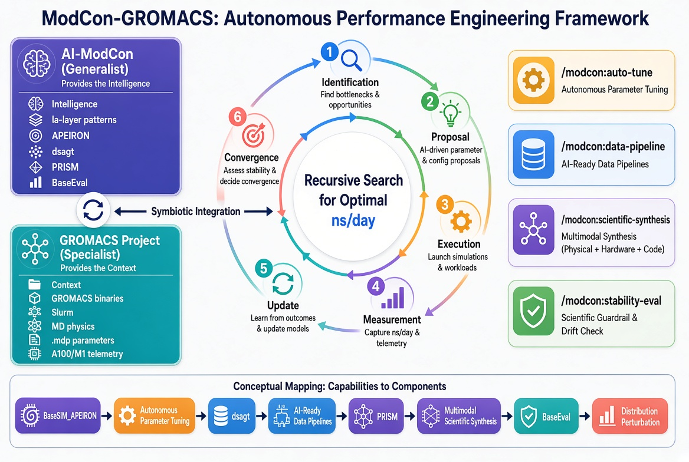

# ModCon-GROMACS: Autonomous Performance Engineering Framework

This document describes the integration of the AI-ModCon general-purpose scientific agent patterns into the GROMACS performance optimization ecosystem. The goal of this integration is to move from manual, expert-guided tuning to an autonomous, self-improving optimization loop.

## 1. Relationship to AI-ModCon

The GROMACS project is a specialized implementation of the AI-ModCon philosophy. While AI-ModCon provides the general-purpose blueprints for agentic science, this project applies those blueprints to the specific, high-performance domain of molecular dynamics.

### How it Relates
The project utilizes the la-layer patterns developed by AI-ModCon to transform GROMACS performance tuning from a manual task into an automated process. It adopts the ModCon approach of using specialized agent personas and recursive improvement loops to reach an optimal state.

### How it Differs
- **Generalist vs. Specialist**: AI-ModCon is a generalist framework. Its tools (like APEIRON or dsagt) are designed to work across any scientific domain. This project is a specialist implementation, deeply integrated with GROMACS binaries, Slurm cluster management, and the specific physics of MD simulations.
- **Primitive vs. Composite**: ModCon provides the "primitives" (the basic agent behaviors). This project provides the "composites"—the specific workflows that combine those primitives to solve a GROMACS-specific problem.
- **Abstract vs. Concrete**: ModCon focuses on the meta-logic of agentic behavior. This project focuses on the concrete execution: the exact `-fno-omit-frame-pointer` flags, the specific `.mdp` parameters, and the real-world hardware telemetry of A100 GPUs.

### How it Complements
The two entities form a symbiotic relationship:
- **ModCon provides the "Intelligence"**: It contributes the la-layer logic for how an agent should search for a solution, how it should prepare data, and how it should verify a result.
- **The GROMACS Project provides the "Context"**: It provides the domain-specific knowledge (GROMACS manual, hardware limits, physics constraints) that allows the ModCon patterns to be applied meaningfully.

Together, they create a system where the generalist power of the ModCon agents is guided by the specialist knowledge of the GROMACS framework, resulting in an autonomous system that is both intelligently efficient and scientifically accurate.

---

## 2. Conceptual Foundation

The ModCon approach treats performance optimization as a recursive search problem. Instead of relying on a human to guess the best parameters, the framework uses an agentic loop to explore the parameter space, measure results, and refine the search model.

... (rest of the content continues)

This implementation maps the general ModCon patterns to specific GROMACS workloads as follows:

| ModCon Pattern | GROMACS Application | Technical Objective |
| :--- | :--- | :--- |
| **BaseSIM_APEIRON** | Autonomous Parameter Tuning | Recursive search for optimal `.mdp` settings to maximize ns/day. |
| **dsagt** | AI-Ready Data Pipelines | Transformation of raw trajectories into tensors for machine learning. |
| **PRISM** | Multimodal Scientific Synthesis | Correlation of physical metrics, hardware telemetry, and code hotspots. |
| **BaseEval** | Distribution Perturbation | Verification of numerical stability and absence of "numerical drift." |

---

## 2. The Integrated Workflow

The ModCon-GROMACS framework operates as a high-level orchestration layer that manages the other components of the project.

### The Optimization Loop
The la-layer follows a strict iterative process:
1. **Identification**: Identify the target parameter (e.g., `nstlist`) and the search range.
2. **Proposal**: The agent proposes a new value based on the current performance gradient.
3. **Execution**: The agent triggers a short benchmark run via the Slurm Bridge MCP.
4. **Measurement**: The agent extracts the ns/day from the log file via the GMX Data Query MCP.
5. **Update**: The agent updates its internal model of the parameter-performance relationship.
6. **Convergence**: The loop terminates when the performance gain falls below a defined threshold (e.g., 1%).

### The Validation Gate
To ensure that performance gains do not compromise the physics, every successful optimization must pass through the Stability Evaluation stage:
- **Baseline Comparison**: The optimized run is compared against a "Golden Standard" reference.
- **Perturbation Testing**: Parameters are slightly varied to ensure the simulation is not in a "brittle" state.
- **Verdict**: Only optimizations that maintain energy stability (measured via `gmx energy`) are accepted.

---

## 3. Detailed Skill Implementation

### /modcon:auto-tune
This skill replaces manual trial-and-error. It leverages a sampling-based search to find the most efficient settings for a specific hardware target (e.g., A100 vs. M1). It integrates the a-priori knowledge of the GROMACS manual with real-time performance data.

### /modcon:data-pipeline
This skill automates the "last mile" of data preparation. It handles the high-volume data reduction (stripping water, striding) and converts the result into a structured format suitable for AI-ready analysis, eliminating the manual preprocessing bottleneck.

### /modcon:scientific-synthesis
This skill acts as the diagnostic brain. It synthesizes three distinct data streams:
- **Physical**: Energy, RMSD, and structural stability.
- **Hardware**: GPU utilization, memory bandwidth, and CPU thermal state.
- **Code**: Call stacks and "Flat Tops" from the profiling API.
The result is a root-cause analysis that explains *why* a simulation is slow.

### /modcon:stability-eval
This skill implements the scientific guardrail. It uses distribution perturbation to ensure that an optimization hasn't introduced non-physical artifacts, verifying that the simulation remains a valid representation of the molecular system.

---

## 4. Deployment and Usage

The ModCon skills are located in `.claude/skills/modcon/` and are designed to be invoked by the AI agent.

**Example Trigger:**
"Use /modcon:auto-tune to optimize the PME settings for this system on the A100 cluster, then use /modcon:stability-eval to verify the results."

This command triggers a complex chain of events:
1. The agent invokes the Slurm Bridge to allocate GPUs.
2. It runs a series of short benchmarks to find the optimal `pme-order`.
3. It verifies the final result using the GMX Manual RAG server.
4. It runs a validation simulation to check for energy drift.
5. It reports the final ns/day increase and the scientific validation status.
