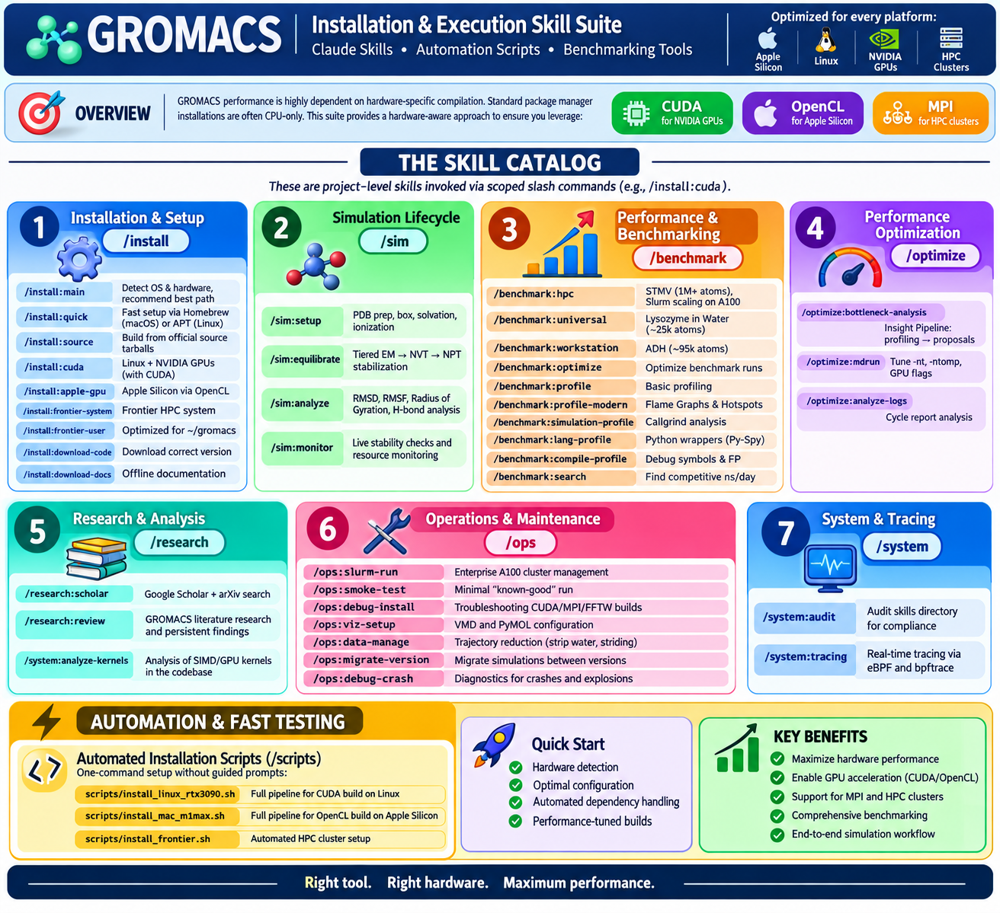

# GROMACS Installation & Execution Skill Suite

This directory contains a specialized set of **Claude Skills**, **Automation Scripts**, and **Benchmarking Tools** designed to optimize GROMACS across diverse hardware—from Apple Silicon laptops to NVIDIA A100 enterprise clusters.

## Overview

GROMACS performance is highly dependent on hardware-specific compilation. Standard package manager installations are often CPU-only. This suite provides a hardware-aware approach to ensure you leverage **CUDA** on NVIDIA GPUs, **OpenCL** on Apple Silicon, and **MPI** on HPC clusters.



---

## The Skill Catalog

These are **project-level skills** invoked via scoped slash commands (e.g., `/install:cuda`).

### 1. Installation & Setup (`/install`)
- **`/install:main`**: The primary entry point. Detects your OS and hardware to recommend the most performant path.
- **`/install:quick`**: Fast setup via Homebrew (macOS) or APT (Linux). Usually **CPU-only**.
- **`/install:source`**: Generic guide for building from official source tarballs.
- **`/install:cuda`**: Tailored for Linux + NVIDIA GPUs. Enables native CUDA acceleration.
- **`/install:apple-gpu`**: Unlocks GPU acceleration for Apple Silicon via OpenCL.
- **`/install:frontier-system`**: Specialized installation for the Frontier HPC system.
- **`/install:frontier-user`**: Optimized installation for the Frontier HPC system targeting `~/gromacs`.
- **`/install:download-code`**: Automates downloading the correct GROMACS version.
- **`/install:download-docs`**: Mirrors the GROMACS documentation for offline use.

### 2. Simulation Lifecycle (`/sim`)
A complete pipeline for taking a protein from a PDB file to a finished trajectory.
- **`/sim:setup`**: PDB preparation, box definition, solvation, and ionization.
- **`/sim:equilibrate`**: Tiered EM $\rightarrow$ NVT $\rightarrow$ NPT stabilization.
- **`/sim:analyze`**: RMSD, RMSF, Radius of Gyration, and H-bond analysis.
- **`/sim:monitor`**: Live stability checks and resource monitoring for production runs.

### 3. Performance & Benchmarking (`/benchmark`)
Standardized tests to baseline and compare performance.
- **`/benchmark:hpc`**: STMV (1M+ atoms). Tests Slurm scaling on A100 clusters.
- **`/benchmark:universal`**: Lysozyme in Water (~25k atoms). Direct comparison across platforms.
- **`/benchmark:workstation`**: ADH (~95k atoms). Tests local Linux hardware.
- **`/benchmark:optimize`**: Logic for optimizing benchmark runs.
- **`/benchmark:profile`**: Basic profiling and bottleneck identification.
- **`/benchmark:profile-modern`**: High-resolution sampling, Flame Graphs, and Hotspot analysis.
- **`/benchmark:simulation-profile`**: Deterministic instruction-level analysis via Callgrind.
- **`/benchmark:lang-profile`**: Sampling profilers for Python wrappers (e.g., Py-Spy).
- **`/benchmark:compile-profile`**: Guidance for building binaries with debug symbols and frame pointers.
- **`/benchmark:search`**: Scours the web for competitive performance metrics (ns/day).

### 4. Performance Optimization (`/optimize`)
Tools to squeeze every ns/day out of your hardware.
- **`/optimize:bottleneck-analysis`**: The "Insight Pipeline"—transforms profiling data into actionable optimization proposals.
- **`/optimize:mdrun`**: Tuning `-nt`, `-ntomp`, and GPU offloading flags.
- **`/optimize:analyze-logs`**: Cycle report analysis to identify hardware bottlenecks.

### 5. Research & Analysis (`/research`)
Academic discovery and mathematical analysis.
- **`/research:scholar`**: Specialized academic search via Google Scholar and arXiv.
- **`/research:review`**: GROMACS literature research and findings persistence.
- **`/system:analyze-kernels`**: Analysis of high-performance SIMD/GPU kernels in the codebase.

### 6. Operations & Maintenance (`/ops`)
Ensuring stability, correctness, and data portability.
- **`/ops:slurm-run`**: Enterprise A100 cluster management and MPI scaling.
- **`/ops:smoke-test`**: Minimal "known-good" run to validate an installation.
- **`/ops:debug-install`**: Troubleshooting guide for CUDA/MPI/FFTW build failures.
- **`/ops:viz-setup`**: VMD and PyMOL configuration for GROMACS trajectories.
- **`/ops:data-manage`**: Trajectory reduction (stripping water, striding) and transport.
- **`/ops:migrate-version`**: Guide for migrating simulations between GROMACS versions.
- **`/ops:debug-crash`**: Diagnostic framework for simulation "explosions" and crashes.

### 7. System & Tracing (`/system`)
Low-level analysis and real-time tracing.
- **`/system:audit`**: Audits the skills directory for compliance with the Agent Skills standard.
- **`/system:tracing`**: Real-time system tracing via eBPF and bpftrace.


---

## Automation & Fast Testing

### Automated Installation Scripts (`/scripts`)
For those who prefer a single-command setup without guided prompts:
- `scripts/install_linux_rtx3090.sh`: Full pipeline for CUDA build on Linux.
- `scripts/install_mac_m1max.sh`: Full pipeline for OpenCL build on Apple Silicon.

### Fast Profiling Environment (`/m1-fast`)
A dedicated "sandbox" for instant performance verification.
- **Dataset**: Contains a tiny water box for near-instant runs.
- **Makefile Targets**:
  - `make automated-install`: Launches the Apple Silicon install script.
  - `make profile`: Runs a 100-step simulation and prints the **ns/day** performance.
  - `make source`: Downloads the GROMACS source code.

---

## Benchmarking Suite

Refer to `benchmarks.md` for the full playbook. Use these skills to instantiate standardized tests:

- **`/benchmark-universal`**: Lysozyme in Water (~25k atoms). Direct comparison across all platforms.
- **`/benchmark-workstation`**: Alcohol Dehydrogenase (ADH, ~95k atoms). Tests local Linux hardware.
- **`/benchmark-hpc`**: Satellite Tobacco Mosaic Virus (STMV, 1M+ atoms). Tests Slurm scaling on A100 clusters.

---

## Repository Structure & Environment

### Directory Layout
- `.claude/skills/`: Project-level instructions for Claude.
- `.claude/skills/benchmarks/`: Specific benchmark instantiation logic.
- `scripts/`: Executable shell scripts for automated setup.
- `m1-fast/`: Rapid profiling environment.
- `dataset/`: (Within m1-fast) Minimal test systems.

### Environment Integration (`.envrc`)
We use `direnv` to make the environment hardware-aware. The `.envrc` file:
1. **Conditional Sourcing**: Automatically detects if a CUDA or OpenCL build exists in `~/software/` and sources the correct `GMXRC`.
2. **Apple Bypass**: Automatically exports `GMX_GPU_DISABLE_COMPATIBILITY_CHECK=1` on macOS.
3. **Path Injection**: Adds `scripts/` and `skills/` subdirectories to the `$PATH`, allowing scripts to be called by name.

---

## Decision Matrix

| Hardware | Goal | Recommended Path | Result |
| :--- | :--- | :--- | :--- |
| **Any** | "I'm not sure where to start" | `/gromacs-install` | Guided Recommendation |
| **macOS / Linux** | "I just need it to work now" | `/gromacs-install-quick` | Fast, CPU-only |
| **Apple Silicon** | "I want my Mac GPU to work" | `/gromacs-install-apple-gpu`| High Performance (OpenCL) |
| **Linux + NVIDIA** | "I have an RTX GPU" | `/gromacs-install-cuda` | Max Performance (CUDA) |
| **Frontier HPC** | "I need a ROCm build on Frontier"| `/user-install-frontier` | Optimized ROCm/ACPP |
| **A100 Cluster** | "I'm running a huge job on Slurm"| `/gromacs-slurm-run` | Enterprise Scaling (MPI) |
| **M1 Fast Test** | "I want to check performance" | `cd m1-fast && make profile` | Instant ns/day metric |

---

## Modern Performance Engineering Workflow

Since profiling is resource-intensive and requires specific binary configurations, these tools are invoked upon explicit request.

**Common Triggers:**
- "I want to profile my GROMACS run on the cluster using modern tools." $\rightarrow$ Use `/install:perf-stack` to verify tools, then `/benchmark:profile-modern` for the Flame Graph pipeline.
- "Why is my Python analysis script so slow?" $\rightarrow$ Use `/benchmark:lang-profile` to attach Py-Spy to the running process.
- "I need to know exactly how many instructions are in this specific kernel." $\rightarrow$ Use `/benchmark:simulation-profile` for a deterministic Callgrind run.
- "Is the simulation hanging because of disk I/O or a kernel lock?" $\rightarrow$ Use `/system:tracing` to write a `bpftrace` script.

Your environment is now equipped with a professional-grade performance engineering workflow that avoids the pitfalls of legacy tools like `gprof` and provides high-resolution visibility for GROMACS optimization.

---

## Appendix: M1 Quick-Start Guide (Install $\rightarrow$ Run $\rightarrow$ Profile)

For users on Apple Silicon who want a streamlined path from installation to performance analysis, use the concrete scripts in `platform/ai/m1/`.

### 1. Installation & Profiling Build
To install GROMACS with the necessary debug symbols and frame pointers for Instruments:
```bash
chmod +x platform/ai/m1/*.sh
./platform/ai/m1/install.sh    # Standard GPU build
./platform/ai/m1/compile.sh    # Profiling-ready build (RelWithDebInfo)
source ~/gromacs_m1_profile/bin/GMXRC
```

### 2. Running & Capturing
To run a short test and get instructions for triggering the macOS profiler:
```bash
./platform/ai/m1/run.sh
```

### 3. Analyzing the Results
To walk through the analysis process in Xcode Instruments:
```bash
./platform/ai/m1/analyze.sh
```

---

## Usage Example

**To install and profile on a Mac:**
1. `cd m1-fast && make automated-install`
2. `direnv allow`
3. `make profile`
