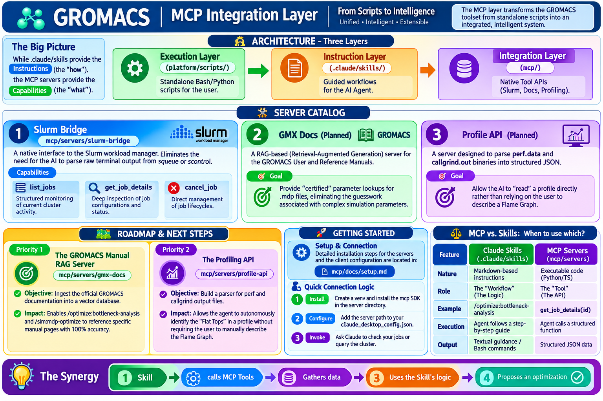

# Agentic GROMACS Performance Engineering Framework

This repository provides a professional-grade ecosystem for the installation, execution, and optimization of GROMACS simulations. It is designed to operate across diverse hardware environments, from Apple Silicon laptops to NVIDIA A100 enterprise clusters.

The framework moves beyond simple scripts by integrating an AI-driven optimization loop that combines native system capabilities with expert domain knowledge.


The overall project architecture consists of three synergistic layers: the Execution Layer for running tools, the Instruction Layer for guided AI workflows, and the Integration Layer for native system access. Together, these enable a closed-loop process of profiling, diagnosing, and optimizing simulation performance.

---

## 🏗️ The Three-Layer Architecture

### 1. Integration Layer (MCP)
The Integration Layer uses the Model Context Protocol (MCP) to provide the AI with structured, native access to the system. Instead of parsing raw text, the AI interacts with specialized servers.


The MCP layer acts as the bridge between the AI and the environment. It provides native APIs for Slurm cluster management, GROMACS manual lookups via RAG, binary profiling data parsing, and real-time hardware telemetry.

- **Core Components**: Slurm Bridge, GMX-Docs RAG, Profile API, and Hardware Telemetry.
- **Detailed Documentation**: [README-MCP.md](README-MCP.md)

### 2. Instruction Layer (Claude Skills)
The Instruction Layer consists of expert-authored "Skills" that define a standardized way to perform complex GROMACS tasks.

- **Installation & Setup (`/install`)**: Hardware-aware paths for CUDA, OpenCL, and Docker.
- **Simulation Lifecycle (`/sim`)**: End-to-end pipeline from PDB preparation to post-processing.
- **Performance & Benchmarking (`/benchmark`)**: Standardized tests and a modern profiling suite (Flame Graphs, Callgrind).
- **Performance Optimization (`/optimize`)**: The "Insight Pipeline" for identifying and fixing bottlenecks.
- **System & Tracing (`/system`)**: Low-level kernel and eBPF tracing.

**For a detailed catalog of all available skills, see [README-SKILL.md](README-SKILL.md).**

### 3. Execution Layer (Standalone Tools)
The Execution Layer provides concrete scripts for users who prefer direct shell interaction without AI guidance.

- **Apple Silicon Toolkit**: Specialized scripts in `platform/ai/m1/` for installation and profiling on M1/M2/M3.
- **Docker Images**: Pre-configured environments for CPU and CUDA workloads in `.claude/skills/install/docker/`.
- **Automation Scripts**: Bash pipelines for CUDA and OpenCL builds in `scripts/`.

---

## 🤖 Agentic AI Framework

The laest evolution of the project is the transition to an autonomous agentic framework. This replaces the "User-guided" approach with a "Goal-driven" approach.


The agentic framework employs a team of specialized AI personas (Architect, Profiler, Optimizer, Validator, and Cluster Op) that collaborate to reach a performance target. The loop involves autonomous profiling, evidence-based optimization via the GMX manual, and scientific validation to ensure that speed gains do not compromise the physics of the simulation.

**For the full agentic blueprint and persona definitions, see [README-AGENT.md](README-AGENT.md).**

---

## 📈 Decision Matrix

| Hardware | Goal | Recommended Path | Result |
| :--- | :--- | :--- | :--- |
| **Any** | "I'm not sure where to start" | `/gromacs-install` | Guided Recommendation |
| **macOS / Linux** | "I just need it to work now" | `/gromacs-install-quick` | Fast, CPU-only |
| **Apple Silicon** | "I want my Mac GPU to work" | `/gromacs-install-apple-gpu`| High Performance (OpenCL) |
| **Linux + NVIDIA** | "I have an RTX GPU" | `/gromacs-install-cuda` | Max Performance (CUDA) |
| **Docker (CPU/GPU)** | "I want an isolated environment" | `/install:docker` | Containerized Setup |
| **Frontier HPC** | "I need a ROCm build on Frontier"| `/user-install-frontier` | Optimized ROCm/ACPP |
| **A100 Cluster** | "I'm running a huge job on Slurm"| `/gromacs-slurm-run` | Enterprise Scaling (MPI) |
| **M1 Fast Test** | "I want to check performance" | `cd m1-fast && make profile` | Instant ns/day metric |

---

## ⚡ Quick Start: M1 Mac

For users on Apple Silicon, follow this streamlined path:

1. **Install & Build**:
   ```bash
   chmod +x platform/ai/m1/*.sh
   ./platform/ai/m1/install.sh    # Standard GPU build
   ./platform/ai/m1/compile.sh    # Profiling-ready build
   source ~/gromacs_m1_profile/bin/GMXRC
   ```
2. **Run & Profile**:
   ```bash
   ./platform/ai/m1/run.sh
   ```
3. **Analyze**:
   ```bash
   ./platform/ai/m1/analyze.sh
   ```
