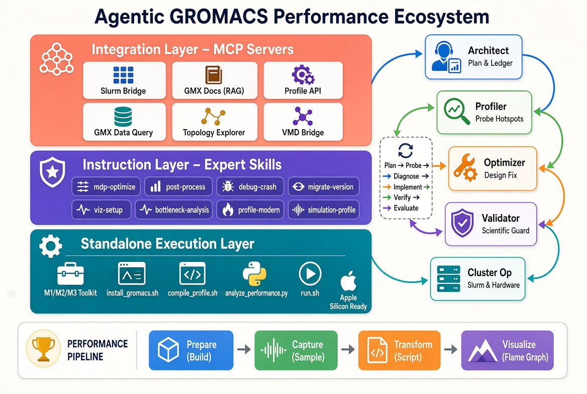

# Project Report: Agentic GROMACS Performance Ecosystem

## Executive Summary
This activity has evolved the GROMACS project from a collection of installation guides into a professional-grade, agentic performance engineering ecosystem. The goal was to transition from "AI-assisted" work (where the user guides the AI) to an "Agentic" workflow (where specialized AI personas autonomously orchestrate the optimization of simulations).

The result is a three-layer architecture comprising a **Standalone Execution Layer** (M1 scripts), an **Instruction Layer** (Expert Skills), and an **Integration Layer** (MCP Servers), all tied together by an **Agentic Framework** designed to maximize simulation performance (ns/day) while maintaining strict scientific validity.

---

## 1. Simulation Lifecycle & Operational Expansion
The core simulation workflow was expanded to provide end-to-end guidance, reducing the risk of user error during the most critical stages of a simulation.

### Key Deliverables:
- **MDP Parameter Optimization (`/sim:mdp-optimize`)**: A guide for selecting physically accurate and numerically stable parameters.
- **Simulation Post-Processing (`/sim:post-process`)**: Standardized workflows for PBC correction, centering, and fitting.
- **Crash Diagnostics (`/ops:debug-crash`)**: A diagnostic framework to translate GROMACS error signatures into actionable fixes.
- **Version Migration (`/ops:migrate-version`)**: A structured approach to updating scripts and `.mdp` files across GROMACS versions.
- **Visualization Setup (`/ops:viz-setup`)**: Enhanced guidance on publication-quality rendering and VMD automation.

---

## 2. The Modern Performance Stack
We replaced legacy instrumentation (e.g., `gprof`) with a high-resolution sampling and tracing stack that provides a transparent view of CPU and GPU bottlenecks.

### The "Modern Gold Standard" Pipeline:
**Prepare (Build)** $\rightarrow$ **Capture (Sample)** $\rightarrow$ **Transform (Script)** $\rightarrow$ **Visualize (Flame Graph)**

### Implemented Skills:
- **`benchmark/compile-profile`**: Enforces `RelWithDebInfo` and `-fno-omit-frame-pointer` to ensure clean call stacks.
- **`benchmark/profile-modern`**: Implements the `perf` $\rightarrow$ `perf script` $\rightarrow$ **Hotspot/Firefox Profiler** workflow.
- **`benchmark/simulation-profile`**: Deterministic instruction-level analysis via **Valgrind/Callgrind**.
- **`benchmark/lang-profile`**: Low-overhead sampling for Python wrappers using **Py-Spy**.
- **`/optimize:bottleneck-analysis`**: The "Brain" skill that transforms raw profiling data into actionable optimization proposals.

---

## 3. The MCP Integration Layer
To eliminate "hallucinations" and manual text parsing, we implemented a Model Context Protocol (MCP) layer. This provides the AI with native, structured APIs to interact with the cluster and the data.

### Implemented MCP Servers:
- **Slurm Bridge**: Native API for cluster job management (`list_jobs`, `get_job_details`).
- **GMX Docs (RAG)**: A FAISS-powered vector search server for the official GROMACS manual, providing evidence-based parameter lookups.
- **Profile API**: A binary parser for `perf.data` and `callgrind.out` that identifies "Flat Tops" programmatically.
- **GMX Data Query**: Structured access to `.log` and `.edr` energy files.
- **Topology Explorer**: API for parsing `.top` and `.itp` force field parameters.
- **VMD Bridge**: Remote control of the VMD Tcl console for automated visualization.
- **`setup_all.sh`**: A one-click orchestrator that manages venvs, dependencies, and `claude_desktop_config.json` generation.

---

## 4. The Agentic AI Framework
The framework moves beyond single-prompt interactions to a multi-agent orchestration pattern.

### The Agent Team:
- **The Architect**: Project manager; defines goals and maintains the Optimization Ledger.
- **The Profiler**: Data gatherer; identifies hotspots and "Flat Tops."
- **The Optimizer**: Physics expert; designs the technical fix using the GMX Manual RAG.
- **The Validator**: Scientific guard; ensures no "numerical drift" or instability.
- **The Cluster Op**: Infrastructure specialist; manages Slurm and hardware telemetry.

**The Loop**: Plan $\rightarrow$ Probe $\rightarrow$ Diagnose $\rightarrow$ Implement $\rightarrow$ Verify $\rightarrow$ Evaluate.

---

## 5. Apple Silicon (M1/M2/M3) Specialization
A dedicated toolkit was created to provide a "Fast Path" for macOS users.

### Deliverables in `platform/scripts/m1/`:
- **`install_gromacs.sh`**: Automated OpenCL GPU installation.
- **`compile_profile.sh`**: High-res profiling build.
- **`run.sh`**: Benchmark execution and Xcode Instruments guide.
- **`analyze_performance.py`**: Standalone Python tool that generates a visual HTML report of bottlenecks.

---

## Summary of Deliverables

| Layer | Components | Key Outcome |
| :--- | :--- | :--- |
| **Instruction** | 15+ Expert Skills | Guided, a-priori knowledge for GROMACS tasks. |
| **Integration** | 6 MCP Servers | Native, structured access to data and hardware. |
| **Execution** | M1 Toolkit & Scripts | One-click deployment and analysis on Apple Silicon. |
| **Orchestration**| Agentic Framework | Autonomous loop for evidence-based optimization. |
| **Documentation** | 4 Comprehensive READMEs | Complete transparency of the system and roadmap. |
